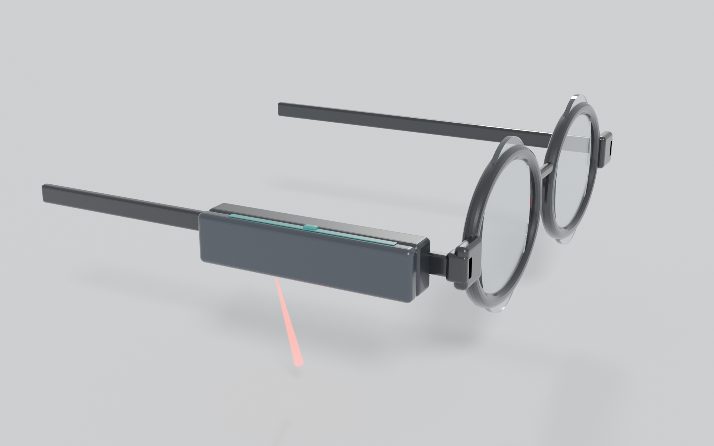
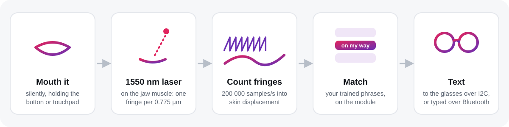
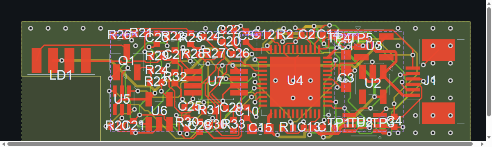
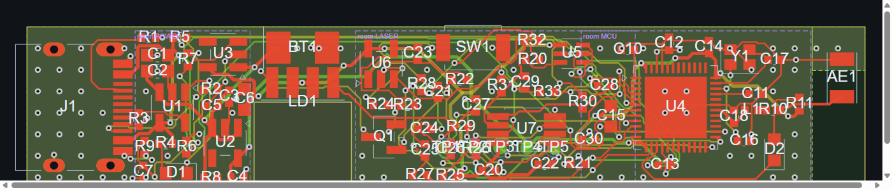
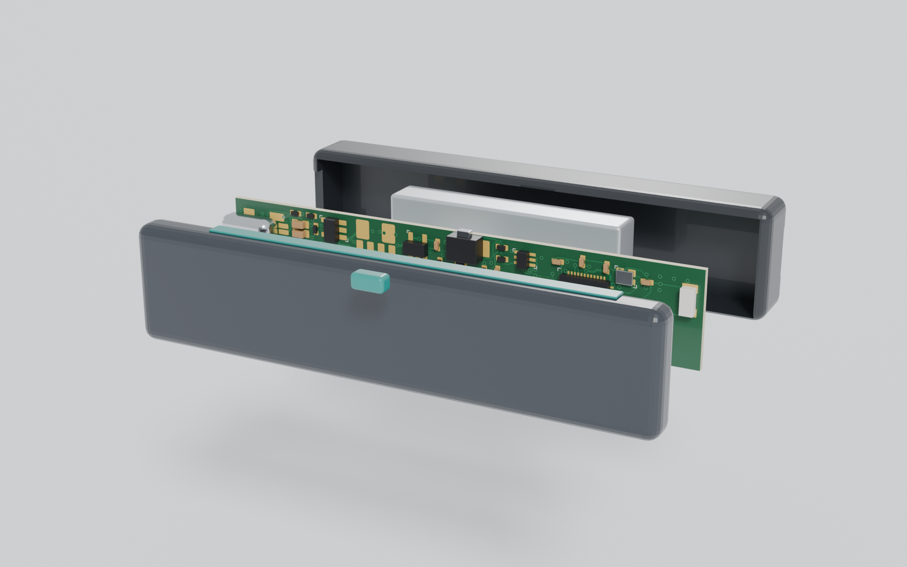
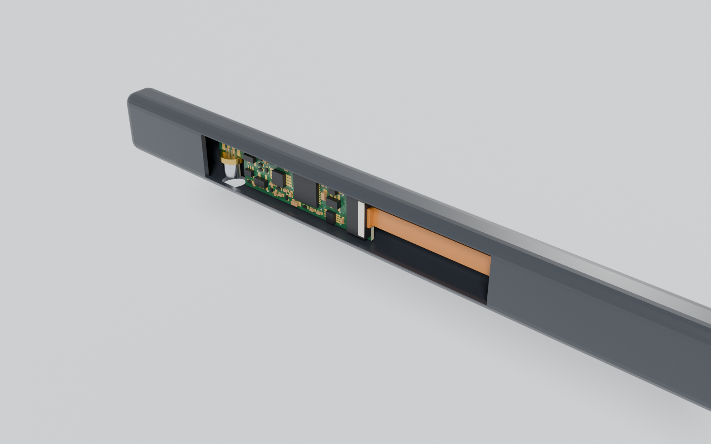

<p align="center">
  <picture>
    <source media="(prefers-color-scheme: dark)" srcset="docs/assets/logo-dark.svg">
    
  </picture>
</p>

<p align="center">
  <b>Talk to your glasses without making a sound.</b><br>
  A 1550 nm laser in the temple reads the micro-movements of your jaw muscle while you silently mouth words,<br>
  and turns them into text: inside smart glasses over I2C, or as a Bluetooth keyboard from a clip-on pod.
</p>

<p align="center">
  
  
  
  
  
  
</p>

<p align="center">
  
</p>

---

A laser diode in the temple of a pair of glasses points down at the jaw muscle. When you mouth words without a sound,
the skin there moves by fractions of a millimetre; the laser measures that movement to under a micrometre, and the
electronics recognise the phrase you trained. Part of the Subvocal family with
[Subvocal Radar](https://github.com/ajisrawi/subvocal-radar) (60 GHz, USB) and
[Subvocal Radar v2](https://github.com/ajisrawi/subvocal-radar-v2) (Bluetooth handheld).

<p align="center">
  
</p>

It comes in two versions with the same sensor and firmware core:

| | **Wired module** (inside smart glasses) | **Bluetooth pod** (clips on any glasses, like Google Glass) |
|---|---|---|
| Size | **11 x 41 mm** board, fits in a temple arm | 12 x 62 mm board in a 65 x 15 x 13 mm pod |
| Link | 6-pin FPC to the glasses' main board: **I2C** + interrupt, at the host's I/O voltage | **Bluetooth LE keyboard** (types into phone or PC), training service |
| Power | from the glasses (3.3-5.5 V) | own 100 mAh LiPo, USB-C charging |
| Talk | the glasses start/stop a take (touchpad, button, wake word...) | hold the side button |
| Training | on the module: the host sends phrase text, the user mouths it 5 times | Subvocal Trainer apps (Windows, Android) from [Subvocal Radar v2](https://github.com/ajisrawi/subvocal-radar-v2) |
| Parts on board | 47 | 67 |

## How it works

1. **Self-mixing interferometry.** A 1550 nm DFB laser shines on the skin. A little of the scattered light goes back
   into the laser and changes its output power. The laser's own monitor photodiode sees one interference fringe per
   **0.775 µm** of movement (half a wavelength). No separate detector, no optics alignment between parts.
2. **Fringe counting.** A transimpedance amplifier and a x21 AC stage feed the nRF52832's ADC at **200 000 samples/s**.
   With moderate optical feedback each fringe is a sawtooth whose steep edge points one way when the skin moves
   towards the glasses and the other way when it moves away; counting edges with their sign gives signed
   displacement, 200 times per second.
3. **Phrase matching.** The displacement trace becomes motion features (displacement and velocity, normalised) that are
   matched by dynamic time warping against your trained takes, the same matcher as Subvocal Radar.
4. **Output.** The wired module raises an interrupt and the glasses read the phrase over I2C; the pod types it as
   Bluetooth key presses.

Why 1550 nm: the eye's front absorbs it before it reaches the retina, so this wavelength allows the highest safe power
(Class 1 up to ~10 mW). This circuit caps the laser current in hardware at 23.4 mA, typically 3-5 mW. See
[docs/LASER.md](docs/LASER.md) for the laser to buy, its wiring, safety and aiming.

## Boards

Both designed, placed, auto-routed and checked with [openpcb](https://github.com/ajisrawi/openpcb) (OpenSchematic,
OpenBoard, OpenRoute) from scripts. 4 layers, 0.8 mm, all parts on the top side for JLCPCB Economic assembly.

<p align="center"><b>Wired module</b>, 11 x 41 mm: laser in the corner cut-out (left), analog front end, nRF52832, I2C level shifter and regulators, FPC connector (right)</p>
<p align="center"></p>
<p align="center"><b>Bluetooth pod</b>, 12 x 62 mm: USB-C and charger (left), laser notch, analog front end, push-to-talk button, nRF52832 and chip antenna (right)</p>
<p align="center"></p>

| | Wired | Bluetooth |
|---|---|---|
| Schematic | [PDF](wired/hardware/subvocal-lidar-wired-schematic.pdf), 53 parts, ERC clean | [PDF](bluetooth/hardware/subvocal-lidar-schematic.pdf), 74 parts, ERC clean |
| Board | fully routed, **0 DRC violations**, pour check clean | fully routed, **0 DRC violations**, pour check clean |
| JLCPCB | [Gerbers, BOM, CPL, ORDER.md](wired/hardware/jlcpcb/) | [Gerbers, BOM, CPL, ORDER.md](bluetooth/hardware/jlcpcb/) |

Shared circuit: DAC7311 sets the laser current through a TLV9061 + MMBT3904 + 47 Ω sink (hardware limit 23.4 mA),
TLV9062 photodiode TIA (2.2 kΩ) and AC gain stage, nRF52832, TPS7A2033 low-noise LDOs (the laser rail is off between
takes). Wired adds a TCA9406 I2C level shifter and the FPC connector; Bluetooth adds the W3008 chip antenna with
Nordic's matching, MCP73831 charger, USB-C, side push-to-talk button and LEDs.

<p align="center">
  
  
</p>

## Firmware

[firmware/](firmware/): shared sensing code plus the two link variants; prebuilt `.hex` images, SWD flashing, the
wired module's I2C register map and the Bluetooth protocol are in [firmware/README.md](firmware/README.md).

## Repository

```
wired/hardware/        wired module: schematic, board, scripts, fab outputs, jlcpcb/
bluetooth/hardware/    Bluetooth pod: schematic, board, scripts, custom footprints, fab outputs, jlcpcb/
bluetooth/enclosure/   printable pod shell, cover and button (STL)
firmware/              common/ sensing + matching, wired/, bluetooth/, test/ (PC tests)
render/                Blender scene and scripts for the images
docs/LASER.md          the laser: what to buy, pins, eye safety, aiming
docs/assets/           logo (SVG, JPG), icon, how-it-works diagram
```

## Status

- ✅ Both schematics pass ERC; both boards fully routed with 0 DRC violations; JLCPCB packages complete.
- ✅ Both firmwares compile (GCC 14, nRF5 SDK 17.1). The fringe counter tracks simulated self-mixing signals within
  1-4 µm in 11 of 12 test cases up to 15 mm/s skin speed (the miss: a tiny 50 µm movement at strong feedback,
  4.7 µm off); the phrase matcher matches the Subvocal Radar decoder exactly (74/74 checks).
- ⏳ **Not built or tested on hardware.** No laser has been aimed at a face yet: the fringe amplitude on real skin,
  the best laser current and how well phrases separate are unknown until the first boards are built.
- ⚠️ The laser's output has not been measured. Measure yours before wearing it (see [docs/LASER.md](docs/LASER.md)).
- ℹ️ The Bluetooth pod's antenna (chip antenna next to the head) is untuned; the board has a tuning pad.
- ℹ️ Phrases are typed with a US keyboard layout: ASCII text works everywhere.

## Rights

© 2026 ajisrawi. All rights reserved. No license is granted: you may view this repository, but copying, modifying or
distributing it requires permission.

Third-party code keeps its own license: `firmware/bluetooth/main.c` is generated from Nordic Semiconductor's nRF5 SDK
example `ble_app_hids_keyboard` and keeps Nordic's licence header (the Nordic 5-clause licence: use with Nordic
devices only); the firmware links Nordic's SDK libraries and the S132 SoftDevice under Nordic's licences.

Not affiliated with or endorsed by Google, The Subvocal Company, Nordic Semiconductor or JLCPCB. Trademarks belong to their owners.
